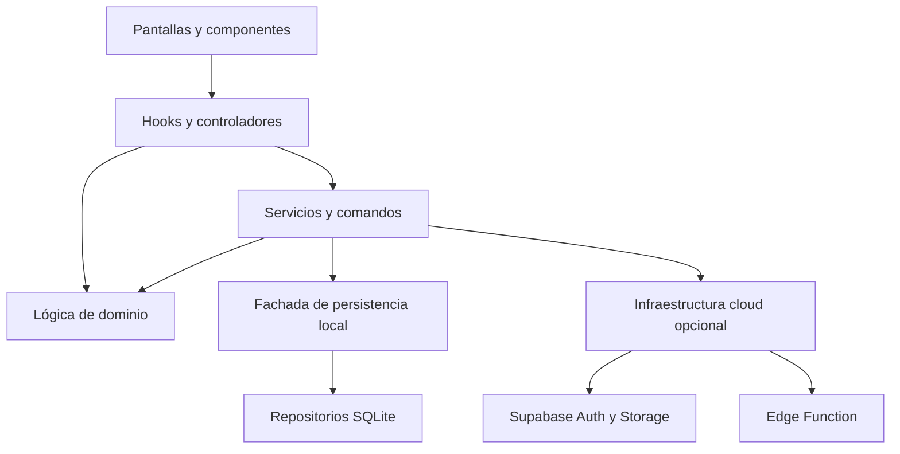

<div align="center">
  
  <h1>Geska</h1>
  <p><strong>Organiza tu tiempo a tu manera.</strong></p>
  <p>Gestión de tareas y tiempo · Local-first · Desarrollo móvil</p>
  <p>
    
    
    
    
    
    
  </p>
</div>

Geska es una aplicación móvil de **gestión del tiempo y organización personal** que permite planificar actividades, gestionar tareas recurrentes y personalizar la experiencia de uso sin depender de una conexión a Internet.

Nació como un proyecto académico y evolucionó hacia un proyecto personal en desarrollo activo. Su objetivo es ofrecer una herramienta flexible que priorice la autonomía del usuario, la claridad y la gestión consciente del tiempo.

> La productividad debería adaptarse a las personas, no las personas a la productividad.

## Funcionalidades

- Creación, edición y organización de tareas, subtareas y categorías.
- Recurrencia diaria, semanal y mensual con intervalos y fechas de término configurables.
- Registro independiente del estado de cada ocurrencia.
- Recordatorios y notificaciones locales.
- Reordenamiento de elementos e interacciones mediante gestos.
- Personalización mediante temas y modos claro y oscuro.
- Persistencia local con SQLite, sin necesidad de crear una cuenta.
- Autenticación opcional, respaldo manual y restauración en la nube mediante Supabase.
- Gestión y eliminación de cuentas.

## Stack tecnológico

| Tecnología | Uso |
| --- | --- |
| JavaScript, React 19.1 | Lenguaje principal, componentes, hooks y estados |
| React Native 0.81.5, Expo SDK 54 | Desarrollo móvil |
| React Navigation | Navegación |
| Reanimated, Gesture Handler | Animaciones e interacciones |
| SQLite (Expo SQLite) | Persistencia local, transacciones y migraciones |
| Supabase | Auth, Storage y Edge Functions |
| AsyncStorage | Preferencias y persistencia de sesión del SDK |
| Node.js Test Runner, Python 3 | Pruebas automatizadas y adaptador de SQLite en memoria |

## Arquitectura

El código se organiza por funcionalidades y separa la presentación, la lógica de dominio y la infraestructura de datos. La nube es opcional: el flujo principal de tareas funciona sin Supabase.



| Directorio | Responsabilidad |
| --- | --- |
| `src/features/tasks/` | Tareas, ocurrencias, edición y recordatorios |
| `src/features/account/` | Gestión de cuenta |
| `src/features/backup/` | Respaldo, validación y restauración |
| `src/features/settings/` | Preferencias de la aplicación |
| `src/storage/sqlite/` | Conexión, migraciones y repositorios |
| `src/storage/supabase/` | Autenticación y acceso a la nube |
| `src/navigation/` | Flujos de navegación |
| `src/styles/` | Temas y estilos |
| `supabase/functions/` | Funciones ejecutadas en el servidor |
| `tests/` | Pruebas automatizadas |

## Decisiones de ingeniería

### Motor de recurrencia

La lógica de calendario contempla fechas locales, intervalos diarios, semanales y mensuales, límites de repetición y meses con distinta duración. Para encontrar la siguiente ocurrencia, salta a los períodos elegibles en lugar de recorrer todas las fechas intermedias. El cálculo por días de calendario evita depender de que cada día dure exactamente 24 horas.

[Ver implementación](src/features/tasks/domain/recurrence.js)

### Persistencia local e integridad de datos

SQLite es la fuente principal de información. Las operaciones relacionadas con tareas y subtareas se agrupan en transacciones; una cola coordina el acceso a la conexión para evitar que otras operaciones se incorporen a una transacción asíncrona. Las migraciones conservan los datos existentes y la eliminación lógica utiliza marcas temporales para registrar cambios.

[Documentación de SQLite](src/storage/sqlite/README.md) · [Comandos de tareas](src/features/tasks/services/taskCommands.md)

### Respaldo y restauración

El respaldo captura las cinco tablas de datos en una transacción y genera un documento JSON versionado. Antes de restaurar, se comprueban el formato, las relaciones entre registros y la identidad de la cuenta. El reemplazo local se realiza de manera atómica y los recordatorios se reconcilian después de confirmar la transacción.

El respaldo es manual y reemplaza la copia anterior. No es un sistema de sincronización automática entre dispositivos ni un mecanismo de combinación de datos.

[Documentación de respaldo y restauración](src/features/backup/README.md)

### Recordatorios

La planificación de recordatorios se separa de las llamadas nativas de Expo. Se utiliza la lógica de recurrencia compartida y se reconcilian las notificaciones existentes con las esperadas, evitando duplicaciones y eliminando solicitudes obsoletas.

[Documentación de recordatorios](src/features/tasks/services/notifications/README.md)

### Autenticación opcional

Supabase se inicializa bajo demanda. Las credenciales administrativas permanecen en el entorno del servidor; la función de eliminación de cuenta verifica la identidad del usuario antes de ejecutar operaciones privilegiadas.

[Documentación de autenticación](src/storage/supabase/README.md) · [Función de eliminación de cuenta](supabase/README.md)

## Pruebas automatizadas

La suite incluye pruebas de recurrencia, fechas, operaciones de tareas, persistencia, migraciones, restauración, autenticación, recordatorios, preferencias visuales y regresiones.

Las pruebas de almacenamiento ejecutan SQL real sobre bases SQLite en memoria mediante un [adaptador en Python](tests/helpers/sqlite_bridge.py), sin utilizar bases de datos personales. Las pruebas automatizadas no sustituyen la validación de funcionalidades nativas en un dispositivo.

```bash
npm test
```

## Instalación y desarrollo

### Requisitos

- Node.js 20.19.4 o posterior compatible con Expo SDK 54 y npm.
- Android Studio, Android SDK y JDK compatibles con Expo para compilar en Android.
- Python 3 para ejecutar las pruebas de SQLite.

```bash
git clone https://github.com/Scarfenn/Geska.git
cd Geska
npm ci
npm run android
```

Para iniciar el servidor de desarrollo después de instalar la compilación de desarrollo:

```bash
npm start
```

También existe el script `npm run ios`, que requiere macOS y Xcode para compilar localmente.

### Configuración opcional de Supabase

Para habilitar las funciones de cuenta y respaldo, copia [`.env.example`](.env.example) a `.env` y completa las variables con los datos de tu propio proyecto de Supabase:

```dotenv
EXPO_PUBLIC_SUPABASE_URL=
EXPO_PUBLIC_SUPABASE_PUBLISHABLE_KEY=
```

La configuración del servidor requiere un bucket privado de respaldos, políticas de acceso por usuario y el despliegue de la función de eliminación de cuenta. Consulta la documentación técnica enlazada arriba. Nunca incluyas claves administrativas en variables `EXPO_PUBLIC_*` ni en el repositorio.

## Estado del proyecto

**v0.9.4 — CloudKeeper**

Geska se encuentra en desarrollo activo. La versión actual incorpora respaldo y restauración en la nube, además de gestión de cuentas y mejoras iterativas en la arquitectura.

Las próximas mejoras se orientan a ampliar las posibilidades de organización, recordatorios y personalización, manteniendo el funcionamiento local y la mantenibilidad como prioridades.

## Autoría

Desarrollado por [Scarfenn](https://github.com/Scarfenn).

El repositorio refleja la evolución de Geska desde su origen académico hasta su desarrollo como proyecto personal, incluyendo decisiones de diseño, pruebas, refactorizaciones y mejoras funcionales.
